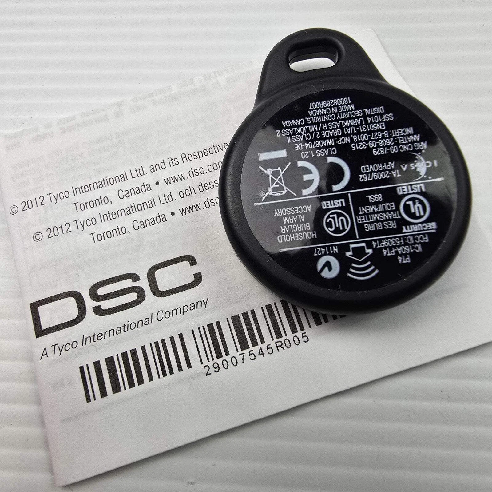

# DSC PT4 Prox tags

The DSC PT4 Proximity Tag is a special device that will automatically disarm a DSC Impassa or PowerSeries Panel. It can only be used if a WT5500P External Keypad is programmed. The PT4 can be held up to the WT5500P to perform an action that would otherwise require a code. Buy the PT4 here.

Source: https://www.alarmgrid.com/products/dsc-pt4