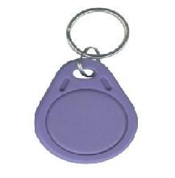

# Honeywell PROXTG

The Honeywell PROXTG is a proximity tag designed for use with a Honeywell 6160PX Keypad. Holding up this convenient accessory to the Honeywell 6160PX Keypad will perform the same action as entering a valid system user code.

Source: https://www.alarmgrid.com/products/honeywell-proxtg

Tech: NFC 

Use PicoPass app to read this sensors